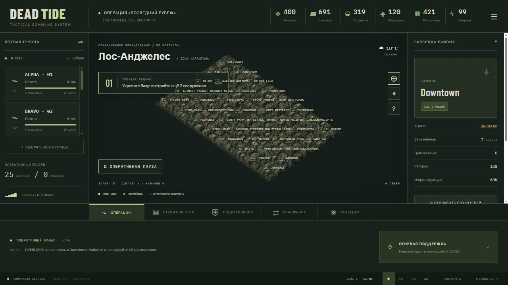
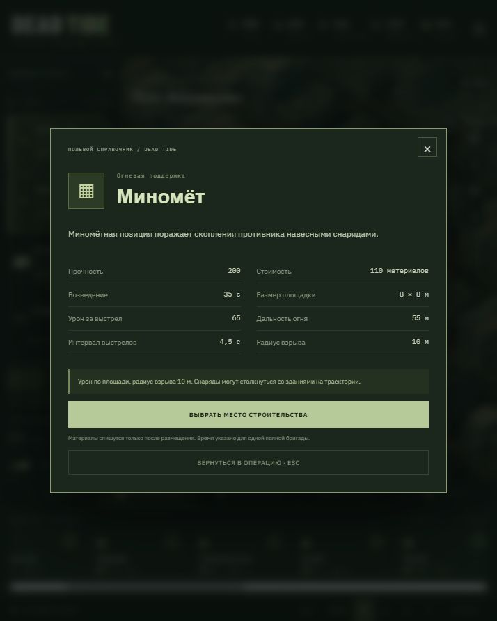

# DEAD TIDE

[Играть в браузере](https://Roman33r.github.io/Game/) · [Исходный код](https://github.com/Roman33r/Game)

Рабочий вертикальный срез браузерной RTS. React + TypeScript + Vite + Three.js + Zustand. Всё вычисляется локально, сервер и аккаунт не требуются.

## Запуск

На этом компьютере: правой кнопкой по `start.ps1` → «Выполнить с помощью PowerShell», либо из терминала `powershell -ExecutionPolicy Bypass -File E:\gam\start.ps1`. Скрипт использует установленный Node и локальный Vite, не меняет системные настройки. Зависимости уже установлены.

На другом компьютере с Node.js 20.19+ и pnpm: `pnpm install`, затем `pnpm dev`. Открыть http://127.0.0.1:5173. Сборка: `pnpm build`, тесты: `pnpm test`. Содержимое `dist` можно разместить на статическом хостинге с HTTPS. Внешние шрифты необязательны: при отсутствии сети используются системные.

## Как играть

- ЛКМ выбирает отряд, протяжка ЛКМ выделяет отряды рамкой. Shift + ЛКМ добавляет отряд или убирает его из выделения; Shift + рамка добавляет отряды к текущему выделению. Панель слева также поддерживает выделение. Двойной клик на карточке центрирует камеру.
- ПКМ отдаёт приказ движения; стрельба по противнику в радиусе огня и на линии видимости автоматическая. Пули и снаряды летят с конечной скоростью: урон наносится при столкновении. Укрытия перехватывают выстрелы. Танковые, миномётные и артиллерийские боеприпасы наносят урон по площади с ослаблением от расстояния и высоты взрыва. WASD, средняя кнопка мыши или Alt + протяжка ЛКМ перемещают камеру, колесо масштабирует её. Tab переключает общий и тактический масштаб одного мира. Клик по району миникарты перемещает к нему камеру.
- Space ставит паузу; 1, 2, 3 выбирают 1×, 2×, 4×. Esc открывает меню. Пауза допускает отдачу приказов и строительство.
- Постройте два сооружения возле инженеров (радиус 38 м). Возведение занимает 8–60 секунд игрового времени в зависимости от типа. Материалы резервируются сразу; на паузе прогресс не идёт. Одна бригада строит один ближайший объект, до двух полных бригад могут ускорить одну стройку. При уходе или гибели инженеров работы останавливаются. Недостроенный объект не стреляет, не производит ресурсы, не лечит и не засчитывается в задачу кампании. Выбор стройплощадки показывает прогресс и оставшееся время; отмена возвращает 65% стоимости невыполненных работ. На готовом объекте доступны ремонт и улучшение.
- Выберите район на карте или миникарте, затем отряд и «Спасать». Отряд прибудет к центру и эвакуирует гражданских, если поблизости нет заражённых.
- Отправьте конвой в разделе снабжения. Прикройте западную дорогу: только живой транспорт доставляет груз. Сопровождение заставляет выбранные отряды следовать за грузовиком.
- Пехота и техника расходуют боезапас; у штаба и арсенала он пополняется из общего резерва. Машины расходуют топливо. Медики и медпункт тратят медикаменты. Продовольствие расходуется на бойцов; голод наносит урон.
- Склад топлива и арсенал пополняют запасы. Если вокруг штаба больше 12 заражённых, производство прекращается. Генератор восстанавливает энергию. Потери уменьшают состав и огневую мощь, погибшие могут превратиться в заражённых.
- Кампания содержит четыре последовательные задачи. Для победы спасите 40 гражданских, доставьте груз и удерживайте три очищенных района. Потеря штаба или всех отрядов заканчивает операцию.
- Сохранение и загрузка доступны в меню; слот хранится в LocalStorage данного браузера. Новая операция не удаляет сохранение.

## Реализованный объём

40 районов на карте 640×400 м; единая изометрическая 3D-сцена; индивидуальные бойцы в отрядах; ограниченная видимость врага; 7 типов отрядов, включая Humvee, танк и грузовик; 5 типов заражённых; 12 типов сооружений; реальные сражения, потери и заражение; экономика, конвои, блокада; спасение; случайные события; 4 задачи кампании; сохранение; звуковые выстрелы (включаются в меню); динамическое освещение и эффекты огня.

Это вертикальный срез, не вся финальная игра из большого ТЗ. Авиация, БТР/БМП, отдельные полицейские и гвардия, полноценная сюжетная кампания с ветвлениями, сложные интерьеры и навигационная сетка с обходом всех городских зданий пока не реализованы. Передвижение использует прямой маршрут; городской декор не блокирует проход. Эвакуация условная: гражданские учитываются в районах без индивидуальных гражданских моделей. Районная разведка показывает оценку угрозы, тогда как сами враги отрисовываются только в зоне видимости. Шум и обнаружение рассчитываются расстоянием.

## Архитектура и проверка

`src/game/types.ts` — сериализуемый мир; `data.ts` — баланс; `world.ts` — генерация; `systems.ts` — симуляция; `store.ts` — команды и сохранение; `commands.ts` — выбор отрядов, группы, построения и общие приказы; `intel.ts` — описания и характеристики из текущего баланса; `ballistics.ts` — траектории, упреждение и непрерывные проверки столкновений; `mapConfig.ts` — единые границы мира; `construction.ts` — стройплощадки, бригады, размещение и отмена; `cityLayout.ts` — единые габариты городских зданий для отрисовки и проверки размещения; `src/render/WorldView.tsx` — камера, ввод и Three.js; `buildingModels.ts` — модели зданий и батчинг города; `combatEffects.ts` — трассеры, вспышки, осколки и дым; `src/ui` — интерфейс. Обновления интерфейса приходят примерно 12 раз в секунду; физика и бой вычисляются шагами не крупнее 1/30 секунды, включая ускорение 2× и 4×. Статусы районов пересчитываются дважды в секунду. Заражённые рисуются через instancing, время кадра ограничено после неактивной вкладки.

44 теста в `tests` проверяют строительство с таймером, очередь бригад, остановку и возобновление, сохранение прогресса и повреждений, возврат материалов, отключение бонусов недостроя, размещение, геометрию моделей, а также паузу, скорость, движение и бой, требования строительства, удаление погибших, доставку и потерю конвоя, эвакуацию, блокаду и длительную устойчивость симуляции.

## Публикация на GitHub Pages

Сайт публикуется из ветки `main`, каталога `/docs`. Для обновления игры выполните `pnpm build:pages`, затем закоммитьте изменённые исходники и `docs` и отправьте в `main`. Сборка использует базовый путь `/Game/`. Файл `docs/.nojekyll` отключает обработку Jekyll.

## Версия 0.2 — инженерные работы

Город получил склады со скатными крышами, жилые дома с пожарными лестницами и водонапорными баками, офисные фасады, витрины, карнизы, вентиляцию и разрушенные корпуса с открытыми перекрытиями и арматурой. Статическая геометрия объединяется по материалам для сокращения числа вызовов отрисовки.

Все 12 военных сооружений имеют свои модели: палатки штаба и медпункта, контейнерный арсенал, топливные цистерны, открытая ремонтная мастерская, генератор, бетонные секции с заграждением, мешки с песком, вышка с лестницей, оружейные позиции и КПП со шлагбаумом. Во время строительства видны фундамент, леса и поэтапно появляющиеся детали. Зелёный или красный контур показывает допустимость размещения; строить поверх городского здания или другой постройки нельзя. Старые сохранения совместимы: прежние сооружения считаются готовыми.

## Версия 0.3 — баллистика и большой город

Карта выросла с 320×240 до 640×400 м: 40 районов вместо 12, более 300 городских зданий и 600 заражённых в начале операции. Границы строительства, камеры и приказов совпадают. Конвой входит с новой западной границы. Старые сохранения автоматически получают внешние районы и орды; исходные отряды, ресурсы, номера районов и незавершённые стройки сохраняются.

Винтовки, разведчики, пулемёты, танки, миномёты и артиллерия используют разные скорости, разброс, гравитацию и темп огня. Есть упреждение движущейся цели, остановка пули на первой цели или препятствии, навесные траектории, вспышки, летящие трассеры, искры, дым, ударное кольцо и краткое дрожание камеры. Артподдержка сначала отправляет снаряд, затем сообщает о попадании и количестве поражённых целей. Пауза останавливает полёт; новые сохранения включают снаряды в воздухе.

Для производительности город разбит на участки с объединённой геометрией, а препятствия для выстрелов индексируются по пространственным ячейкам. Столкновения используют упрощённые объёмы зданий и бойцов; разрушение фасадов, рикошеты и пробитие материалов не моделируются. Взрывной урон учитывает расстояние по трём осям, но не затенение взрыва стенами. Огонь по своим отключён. Городские здания блокируют выстрелы, но автоматический обход препятствий при движении остаётся ограничением вертикального среза.

## Версия 0.4 — справочник и управление группами

Все 12 построек, 7 типов подразделений и 6 ресурсов получили описания. Иконки ресурсов нарисованы в SVG и используются в верхней панели и стоимости действий. Нажатие на ресурс открывает справочник: назначение, источники, расход и последствия дефицита. В справочнике можно переключаться между всеми ресурсами, включая скрытые на узком экране.

Кнопка `i` на карточках строительства и подкреплений открывает описание до покупки. Показаны стоимость, время и размер стройки, прочность, дальность, урон, темп огня, скорость, обзор, состав и специальные возможности. У выбранной боевой единицы урон пересчитывается по живому составу и морали; у сооружения учитываются улучшения. Конвой вызывается за топливо, а не покупается как боевой отряд.

- ЛКМ + протяжка: рамка выделения; Shift + рамка: добавить к выделению.
- Shift + клик: добавить / убрать отряд. Ctrl+A: все боевые отряды.
- ПКМ: общий приказ движения с раздельными конечными позициями для каждого отряда. Скорость движения у каждого подразделения своя; это не синхронный марш строем.
- Группы `4`–`9`: Shift + цифра записывает выбранные отряды; цифра вызывает группу. Есть кнопки записи и вызова в левой панели. Поддерживается цифровая клавиатура. Клавиши `1`–`3` сохраняют управление скоростью времени.
- Приказы удержания, спасения района, отступления, гарнизона и сопровождения действуют на всю выбранную группу. Охрана конвоя сохраняет разные позиции относительно грузовика.
- Группы входят в сохранение, погибшие отряды автоматически удаляются из их состава. Старые сохранения загружаются с пустыми слотами групп.
- На узком экране кнопка `▤` справа от карты открывает панель характеристик, а у выделенной группы есть кнопка «Хар-ки» и быстрые общие приказы.

Исправлено лечение отрядов с нулевым здоровьем: медики и медпункты больше не восстанавливают уже погибшие подразделения.

