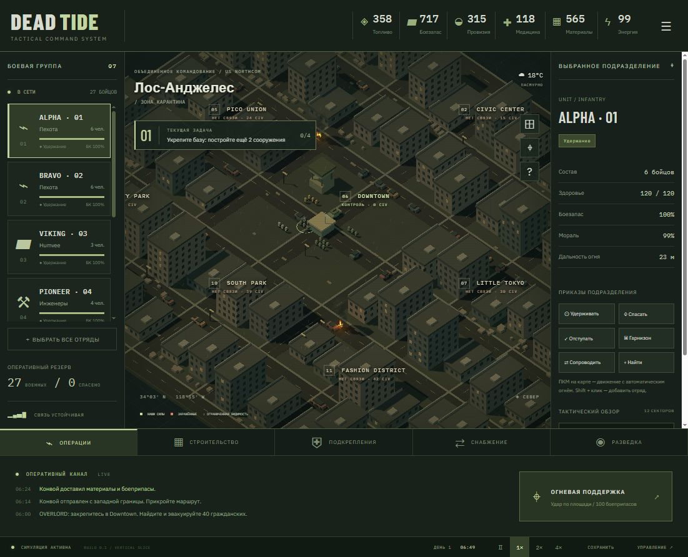

# DEAD TIDE

[Играть в браузере](https://Roman33r.github.io/Game/) · [Исходный код](https://github.com/Roman33r/Game)

Рабочий вертикальный срез браузерной RTS. React + TypeScript + Vite + Three.js + Zustand. Всё вычисляется локально, сервер и аккаунт не требуются.

## Запуск

На этом компьютере: правой кнопкой по `start.ps1` → «Выполнить с помощью PowerShell», либо из терминала `powershell -ExecutionPolicy Bypass -File E:\gam\start.ps1`. Скрипт использует установленный Node и локальный Vite, не меняет системные настройки. Зависимости уже установлены.

На другом компьютере с Node.js 20.19+ и pnpm: `pnpm install`, затем `pnpm dev`. Открыть http://127.0.0.1:5173. Сборка: `pnpm build`, тесты: `pnpm test`. Содержимое `dist` можно разместить на статическом хостинге с HTTPS. Внешние шрифты необязательны: при отсутствии сети используются системные.

## Как играть

- ЛКМ выбирает отряд, Shift + ЛКМ добавляет к выделению. Панель слева также поддерживает выделение. Двойной клик на карточке центрирует камеру.
- ПКМ отдаёт приказ движения; стрельба по противнику в радиусе огня автоматическая. WASD или перетаскивание перемещают камеру, колесо масштабирует её. Tab переключает общий и тактический масштаб одного мира.
- Space ставит паузу; 1, 2, 3 выбирают 1×, 2×, 4×. Esc открывает меню. Пауза допускает отдачу приказов и строительство.
- Постройте два сооружения возле инженеров (радиус 38 м). Материалы списываются сразу. Выбор сооружения открывает ремонт и улучшение.
- Выберите район на карте или миникарте, затем отряд и «Спасать». Отряд прибудет к центру и эвакуирует гражданских, если поблизости нет заражённых.
- Отправьте конвой в разделе снабжения. Прикройте западную дорогу: только живой транспорт доставляет груз. Сопровождение заставляет выбранные отряды следовать за грузовиком.
- Пехота и техника расходуют боезапас; у штаба и арсенала он пополняется из общего резерва. Машины расходуют топливо. Медики и медпункт тратят медикаменты. Продовольствие расходуется на бойцов; голод наносит урон.
- Склад топлива и арсенал пополняют запасы. Если вокруг штаба больше 12 заражённых, производство прекращается. Генератор восстанавливает энергию. Потери уменьшают состав и огневую мощь, погибшие могут превратиться в заражённых.
- Кампания содержит четыре последовательные задачи. Для победы спасите 40 гражданских, доставьте груз и удерживайте три очищенных района. Потеря штаба или всех отрядов заканчивает операцию.
- Сохранение и загрузка доступны в меню; слот хранится в LocalStorage данного браузера. Новая операция не удаляет сохранение.

## Реализованный объём

12 районов; единая изометрическая 3D-сцена; индивидуальные бойцы в отрядах; ограниченная видимость врага; 7 типов отрядов, включая Humvee, танк и грузовик; 5 типов заражённых; 12 типов сооружений; реальные сражения, потери и заражение; экономика, конвои, блокада; спасение; случайные события; 4 задачи кампании; сохранение; звуковые выстрелы (включаются в меню); динамическое освещение и эффекты огня.

Это вертикальный срез, не вся финальная игра из большого ТЗ. Авиация, БТР/БМП, отдельные полицейские и гвардия, полноценная сюжетная кампания с ветвлениями, сложные интерьеры и навигационная сетка с обходом всех городских зданий пока не реализованы. Передвижение использует прямой маршрут; городской декор не блокирует проход. Эвакуация условная: гражданские учитываются в районах без индивидуальных гражданских моделей. Строительство мгновенное. Районная разведка показывает оценку угрозы, тогда как сами враги отрисовываются только в зоне видимости. Шум и обнаружение рассчитываются расстоянием.

## Архитектура и проверка

`src/game/types.ts` — сериализуемый мир; `data.ts` — баланс; `world.ts` — генерация; `systems.ts` — симуляция; `store.ts` — команды и сохранение; `src/render/WorldView.tsx` — камера, ввод и Three.js; `src/ui` — интерфейс. Симуляция работает примерно на 12 Гц независимо от отрисовки. Заражённые рисуются через instancing, время кадра ограничено после неактивной вкладки.

`tests/simulation.test.ts` проверяет паузу, скорость, движение и бой, требования строительства, удаление погибших, доставку и потерю конвоя, эвакуацию, блокаду и длительную устойчивость симуляции.

## Публикация на GitHub Pages

Сайт публикуется из ветки `main`, каталога `/docs`. Для обновления игры выполните `pnpm build:pages`, затем закоммитьте изменённые исходники и `docs` и отправьте в `main`. Сборка использует базовый путь `/Game/`. Файл `docs/.nojekyll` отключает обработку Jekyll.

